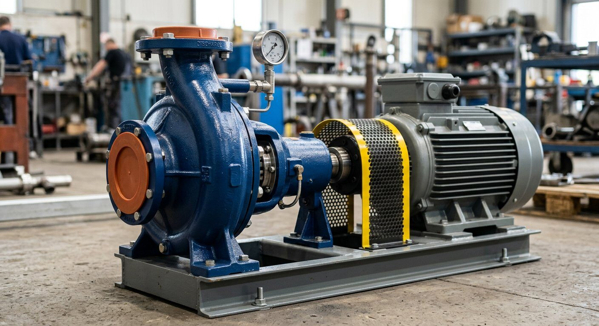

# راهنمای تبدیل تصاویر به WebP

## 📊 وضعیت فعلی

- **کل تصاویر:** ۵۰۵ فایل
- **WebP:** ۹۴ فایل (۱۸.۶٪)
- **JPG/PNG:** ۴۱۱ فایل (۸۱.۴٪)
- **تصاویر بزرگ (>100KB):** ۱۹۰ فایل
- **حجم کل تصاویر:** ۶۲.۵۸ MB
- **حجم تصاویر غیر WebP:** ۴۱.۴۲ MB

## 🎯 اهداف بهینه‌سازی

1. کاهش حجم تصاویر تا ۶۰-۷۰٪
2. بهبود Core Web Vitals (LCP, CLS)
3. کاهش زمان بارگذاری صفحه

## 🔧 روش‌های تبدیل

### روش ۱: استفاده از cwebp (Command Line)

نصب cwebp:
```bash
# Ubuntu/Debian
sudo apt-get install webp

# macOS
brew install webp

# Windows
# دانلود از https://developers.google.com/speed/webp/docs/prebuilt
```

تبدیل یک فایل:
```bash
cwebp -q 80 input.jpg -o output.webp
```

تبدیل دسته‌ای (Linux/macOS):
```bash
find assets/images -name "*.jpg" -o -name "*.jpeg" -o -name "*.png" | while read file; do
  cwebp -q 80 "$file" -o "${file%.*}.webp"
done
```

### روش ۲: استفاده از ImageMagick

```bash
# نصب
sudo apt-get install imagemagick

# تبدیل
magick input.jpg -quality 80 output.webp
```

### روش ۳: استفاده از Squoosh (Web App)

1. رفتن به https://squoosh.app/
2. آپلود تصویر
3. انتخاب WebP به عنوان خروجی
4. تنظیم کیفیت (پیشنهاد: ۸۰-۸۵)
5. دانلود و جایگزینی

### روش ۴: استفاده از Sharp (Node.js)

```javascript
const sharp = require('sharp');
const fs = require('fs');
const path = require('path');

async function convertToWebp(inputPath, outputPath, quality = 80) {
  await sharp(inputPath)
    .webp({ quality })
    .toFile(outputPath);
}

// تبدیل دسته‌ای
const inputDir = 'assets/images';
const files = fs.readdirSync(inputDir);

files.forEach(file => {
  if (file.match(/\.(jpg|jpeg|png)$/i)) {
    const inputPath = path.join(inputDir, file);
    const outputPath = inputPath.replace(/\.(jpg|jpeg|png)$/i, '.webp');
    convertToWebp(inputPath, outputPath);
  }
});
```

## 📋 لیست تصاویر بحرانی (اولویت بالا)

این تصاویر در صفحات critical استفاده می‌شوند و باید ابتدا تبدیل شوند:

### تصاویر Hero
- `assets/images/real/real-hero-energy-plant.jpg` (۳۲۹ KB)
- `assets/images/real/boilers-generic.jpeg` (۳۴۵ KB)
- `assets/images/real/piping-flanges.webp` (✅ قبلاً WebP)

### تصاویر About Section
- `assets/images/real/closeup-pump.jpg` (۳۲۰ KB)
- `assets/images/real/closeup-instrumentation.jpg`
- `assets/images/certificates/chairman.png` (۲۹۹ KB)

### تصاویر Services
- `assets/images/electrical-instrumentation.jpg` (۳۳۰ KB)
- `assets/images/piping-valves.jpg` (۳۱۸ KB)
- `assets/images/real/supply-logistics.jpg` (۳۴۰ KB)

## 🔄 به‌روزرسانی HTML پس از تبدیل

پس از تبدیل تصاویر به WebP، باید HTML را به‌روزرسانی کنید:

### روش ۱: استفاده از `<picture>` (پیشنهادی)

```html
<picture>
  <source type="image/webp" srcset="assets/images/real/closeup-pump.webp">
  
</picture>
```

### روش ۲: جایگزینی مستقیم

```html

```

**توجه:** روش ۲ فقط در صورتی استفاده شود که تمام مرورگرهای هدف از WebP پشتیبانی کنند.

## 📊 معیارهای کیفیت

| نوع تصویر | کیفیت پیشنهادی | توضیحات |
|-----------|----------------|---------|
| Hero Images | ۸۵-۹۰ | کیفیت بالا برای تصاویر اصلی |
| Product Images | ۸۰-۸۵ | تعادل بین کیفیت و حجم |
| Thumbnails | ۷۰-۷۵ | حجم کمتر اولویت دارد |
| Logos (PNG) | Lossless | برای حفظ شفافیت |

## 🧪 تست پس از تبدیل

1. **بررسی ابعاد:**
   ```bash
   identify output.webp
   ```

2. **بررسی حجم:**
   ```bash
   ls -lh output.webp
   ```

3. **تست در مرورگر:**
   - باز کردن صفحه در Chrome DevTools
   - بررسی تب Network
   - بررسی تب Lighthouse

## 📈 انتظار بهبود

پس از تبدیل ۱۹۰ تصویر به WebP:

| معیار | قبل | بعد | بهبود |
|-------|-----|------|--------|
| حجم کل تصاویر | ۶۲.۵۸ MB | ~۲۵ MB | ۶۰٪ |
| LCP | ~۳.۵s | ~۲.۰s | ۴۳٪ |
| Total Page Size | ~۸۰ MB | ~۴۵ MB | ۴۴٪ |

## 🚀 اسکریپت خودکارسازی

یک اسکریپت ساده برای تبدیل و به‌روزرسانی HTML:

```bash
#!/bin/bash

# 1. تبدیل تصاویر
find assets/images -type f \( -name "*.jpg" -o -name "*.jpeg" -o -name "*.png" \) | while read file; do
  webp_file="${file%.*}.webp"
  if [ ! -f "$webp_file" ]; then
    echo "Converting: $file"
    cwebp -q 80 "$file" -o "$webp_file"
  fi
done

# 2. به‌روزرسانی HTML (احتیاط: قبل از اجرا backup بگیرید)
# find . -name "*.html" -type f -exec sed -i 's/\.jpg"/.webp"/g' {} \;
# find . -name "*.html" -type f -exec sed -i 's/\.jpeg"/.webp"/g' {} \;
# find . -name "*.html" -type f -exec sed -i 's/\.png"/.webp"/g' {} \;

echo "✅ Conversion complete!"
```

## ⚠️ نکات مهم

1. **Backup:** قبل از تبدیل، از تصاویر اصلی backup بگیرید
2. **Testing:** پس از تبدیل، تمام صفحات را تست کنید
3. **Fallback:** از `<picture>` با fallback JPG استفاده کنید
4. **Dimensions:** width و height را حفظ کنید (جلوگیری از CLS)
5. **Alt Text:** alt text را تغییر ندهید

## 📚 منابع

- [WebP Documentation](https://developers.google.com/speed/webp)
- [Squoosh App](https://squoosh.app/)
- [Sharp Library](https://sharp.pixelplumbing.com/)
- [Core Web Vitals](https://web.dev/vitals/)
